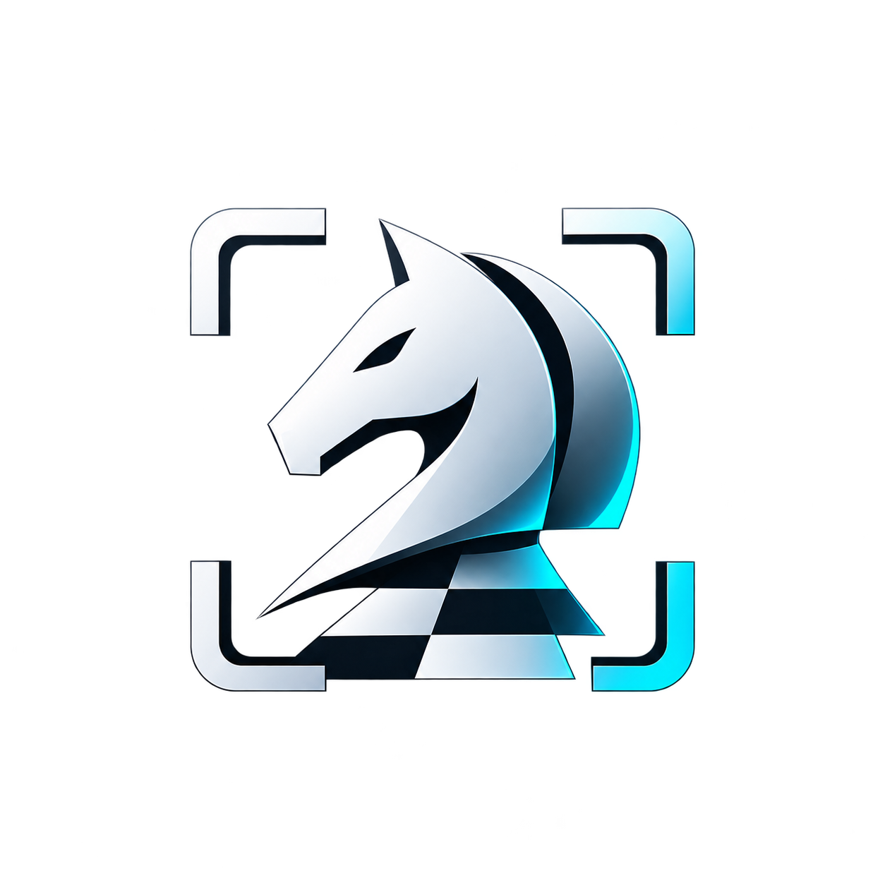

<p align="center">
  
</p>

<h1 align="center">ChessOnGlass</h1>

<p align="center">
  <strong>Local-first, cross-platform AI chess assistant for smart glasses, webcams, window capture, and video replay.</strong>
</p>

<p align="center">
  
  
  
  
</p>

---

**ChessOnGlass** watches a live chessboard from smart glasses, a USB webcam, a captured desktop window, or a recorded video. It identifies moves via vision AI, validates legal play, computes the strongest reply with a local Stockfish engine, highlights the suggested move on an interactive dashboard/overlay, and speaks it aloud — with **no WhatsApp, no BlackHole, no macOS-only audio routing, and no hosted backend**.

## End-to-End Pipeline

```text
Smart Glasses / Webcam / Window Capture (WGC) / Video Replay (FFmpeg)
        │
        ▼
  Bounded Frame Ingestion (LatestFrameMailbox · drop stale/frozen frames)
        │
        ▼
  AI Vision Board Reader (OpenAI / Anthropic · strict CostLedger budget cap)
        │
        ▼
  Corroborated Legal Move Matcher (@chessonglass/chess + GameCoordinator)
        │
        ▼
  Local Stockfish UCI Engine (@chessonglass/platform)
        │
        ▼
  Live Dashboard SVG Arrow + Overlay Renderer + Native Voice Readout (TTS)
```

## Features

- **Multiple live sources:**
  - **Smart Glasses / Webcam:** stream directly from any UVC camera or browser webcam.
  - **Window Capture (WGC):** capture a smart-glasses cast window (e.g. Meta View / phone mirror) or online board window on Windows.
  - **Video Replay:** step through local `.mp4` recordings via FFmpeg.
- **Vision AI with cost control:** supports OpenAI and Anthropic vision models with pre-call reservation and post-call token settlement (`CostLedger`). Paid calls pause automatically at your configured USD ceiling.
- **Local Stockfish engine:** runs locally over UCI (`shell: false`, explicit argument arrays) with zero cloud engine dependency.
- **Voice & visual guidance:** renders a live SVG board with golden move arrows, supports projected board overlays and bounded MP4 overlay exports, and reads moves aloud through native speech synthesis.
- **Local-first security:** binds exclusively to `127.0.0.1` with a 256-bit Bearer token, exact `Origin` checks, OS keyring credential storage (`@napi-rs/keyring`), and SHA-256 verified tool downloads.

## Quick Start

Requires **Node.js 24 LTS** or newer.

```sh
# 1. Install dependencies and build all packages + UI
npm ci
npm run build

# 2. Verify local environment and capabilities
node packages/app/dist/cli.js doctor

# 3. Install SHA-256 verified Stockfish & FFmpeg binaries (if not already present)
node packages/app/dist/cli.js install-tools

# 4. Launch ChessOnGlass
node packages/app/dist/cli.js run
```

To analyze a recorded video directly:

```sh
node packages/app/dist/cli.js run --replay path/to/game.mp4
```

Once the dashboard opens at `http://127.0.0.1:<port>`:
1. In **AI Vision, Voice & Engine**, select **OpenAI** or **Anthropic**, choose a model, save your API key (stored in your OS keyring), enable **AI Vision** and **Voice Readout**, and click **Save Settings**.
2. Start your **Glasses / Webcam Feed** or pick a window in **Window Capture**.
3. Play your game — ChessOnGlass tracks each move, highlights the best reply on the board, and speaks it aloud.

## Workspace Packages

| Package | Responsibility |
|---|---|
| `@chessonglass/contracts` | Branded session/source/frame IDs, `LatestFrameMailbox`, observation & position contracts |
| `@chessonglass/platform` | OS paths, native keyring (`@napi-rs/keyring`), bounded process runner, SHA-256 verified artifact installer, Stockfish UCI adapter |
| `@chessonglass/chess` | `chess.js`-backed legal state, history/PGN, position candidates, corroborated observation-to-move matching |
| `@chessonglass/perception` | `BoardReader` contract, OpenAI/Anthropic vision readers, board homography & projection, freshness-aware locator, SVG/PNG overlay renderer |
| `@chessonglass/game` | Single-writer `GameCoordinator`, stale-result rejection, `CostLedger`, atomic resumable journal, result sinks, evaluation harness |
| `@chessonglass/app` | CLI (`run`, `doctor`, `install-tools`), loopback HTTP/SSE server, Browser/WGC/FFmpeg sources, Windows `System.Speech` helper, FFmpeg overlay exporter |
| `@chessonglass/ui` | Accessible Vite SPA dashboard with live SVG board, move-suggestion arrow, webcam uploader, window picker, and settings/keyring UI |

## Documentation

- [Architecture Guide](docs/architecture.md) — dependency rules, concurrency model, cost accounting, and persistence
- [Setup & Usage Guide](docs/setup-and-usage.md) — installation, smart glasses workflows, voice setup, and troubleshooting
- [Local API Reference](docs/api-reference.md) — authenticated loopback HTTP & SSE endpoints
- [Contributing Guide](CONTRIBUTING.md) — development workflow and PR checklist
- [Security Policy](SECURITY.md) — local-first threat model and vulnerability reporting

## Verification Commands

```sh
npm run typecheck                                # TypeScript project-reference check
npm --workspace=@chessonglass/ui run typecheck   # UI TypeScript check
npm run build                                    # Build all packages + Vite UI bundle
npm run check:brand                              # Brand asset SHA-256, metadata & hygiene checks
npm run test:unit                                # Run unit & integration suite (67 files / 543 tests)
npm run eval -- --simulate                       # Deterministic oracle-free evaluation fixture
```
